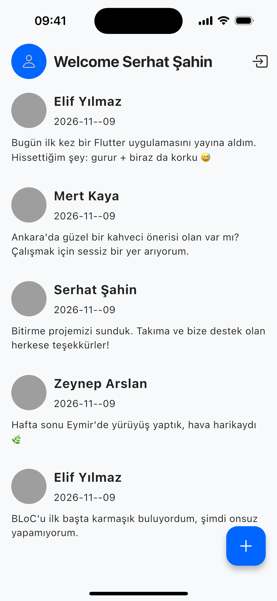

# bloc_socialmedia_app

A social media app built with Flutter. Users sign up, share short posts and see everyone's posts in a single feed.

<p align="center">
  
</p>

## Features

- Email and password sign up and sign in with Firebase Authentication
- Create text posts (up to 500 characters) and browse the shared feed
- Profile picture upload with image picking and cropping
- User and post data stored in Cloud Firestore, images in Firebase Storage

## Tech Stack

- **Framework:** Flutter (Dart)
- **State management:** `flutter_bloc` with separate blocs for authentication, sign in, sign up, posts and user info
- **Backend:** Firebase Authentication, Cloud Firestore, Firebase Storage
- **Architecture:** data access lives in two local packages, `user_repository` and `post_repository`, so the UI never talks to Firebase directly

## Project Structure

```text
lib/
  blocs/          # authentication, sign in/up, create/get post, user info blocs
  screens/        # authentication and home screens
  components/     # shared widgets
packages/
  user_repository/   # user model + Firebase implementation
  post_repository/   # post model + Firebase implementation
```

## Running

```bash
flutter pub get
flutter run
```

The app needs a Firebase project. Configure it with `flutterfire configure`.
